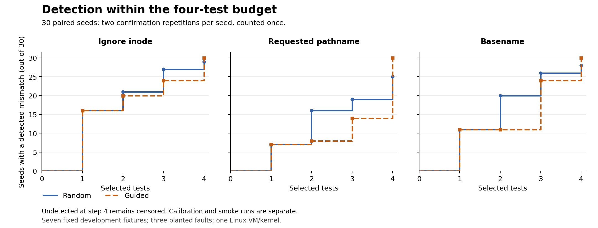

# Sentinel

**Kernel-level execution-policy enforcement and specification-guided testing for Linux (eBPF-LSM + cgroup v2).**

Sentinel tests a Linux `bprm_check_security` rule that allows one executable file (identified by device major, device minor, and inode) inside a chosen cgroup v2 workload and denies other executables with `EPERM`. It also provides a cgroup-scoped sandbox demo for untrusted AI agents.

```
Controlled case ─┬─► Python model (expected_decision) ──┐
                 │                                      ├─► Compare & detect fault
                 └─► eBPF-LSM enforcer ─► ELF marker / EPERM / exit status
```

## Key Results (30-Seed Pilot)

Each strategy selects 4 distinct cases per seed across 30 paired seeds (2,280 controlled execution attempts on Ubuntu 24.04.2, kernel `6.8.0-149-generic`, BPF-LSM active).

| Planted fault | v0 Random (by test 2 / 4) | v0 Guided (by test 2 / 4) | v1 Guided (by test 2 / 4)* |
|---|---:|---:|---:|
| Ignore inode | 21/30 → 29/30 | 20/30 → **30/30** | **30/30** → **30/30** |
| Requested pathname | 16/30 → 25/30 | 8/30 → **30/30** | **30/30** → **30/30** |
| Basename | 20/30 → 28/30 | 11/30 → **30/30** | **30/30** → **30/30** |

*\*v0 numbers are verified kernel runs (`docs/pilot_results_v0.md`); v1 numbers are from the pure-Python `selection_plan_v1.py` simulation fixing v0's step-1 15-token tie.*



## Repository Structure

| Path | Purpose |
|---|---|
| `policy_model.py` | Expected-decision oracle and file-identity fixtures |
| `enforcement_check.py` | Scoped eBPF-LSM enforcer and independent ELF-marker/errno harness |
| `scope_handle_check.py` | Canonical userspace cgroup v2 ID lookup via `name_to_handle_at()` |
| `mutant_*_check.py` | Three deliberate fault mutants (`ignore_inode`, `path`, `basename`) |
| `selection_plan.py` / `selection_plan_v1.py` | Frozen v0 selectors and boundary-weighted v1 selector |
| `selection_kernel.py` / `selection_batch.py` | 30-seed kernel runner and durable audit launcher |
| `agent_sandbox_demo.py` | Untrusted AI-agent cgroup sandbox demo (uses the BPF-LSM enforcer) |
| `analyse_pilot_v0.py` / `plot_pilot_v0.py` | Read-only v0 evidence verifier and figure generator |
| `docs/`, `results/`, `tests/` | Specifications, frozen v0 pilot data, and pure-Python unit tests |
| `archive/` | Earlier class prototypes (`phase3_sentinel.py`, `phase4_demo.py`, `scope_identity_check.py`) |
| `report/` | Standalone research report (separate from code) |

## Quick Reproduce (No Sudo / No BPF Required)

```bash
/usr/bin/python3 analyse_pilot_v0.py --check-derived results/pilot_analysis_v0
/usr/bin/python3 selection_plan_v1.py --compare-v0
/usr/bin/python3 agent_sandbox_demo.py --model-only
/usr/bin/python3 -m unittest discover -s tests -v
```
