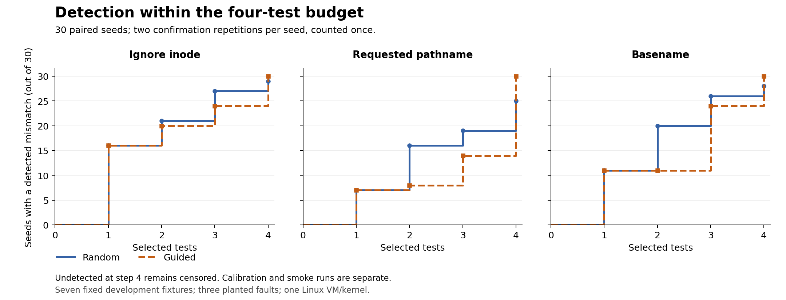

# Sentinel

**Research direction:** Reactive, Specification-Guided Testing of Linux Execution Policies

**Current status: a frozen thirty-seed kernel pilot is complete.** Guided selection detected each of three planted faults within four tests in 30/30 seeds; random detected them in 29/30, 25/30 and 28/30 seeds. Random often detected faults earlier. These are descriptive results on seven known development fixtures in the project's own reference enforcer.

## Thirty-seed pilot results (2026-11-11)

Both strategies selected four distinct cases per seed under the protocol frozen in 1189529. Main collection used source commit 8c6780a, seeds 0..29 and two fresh confirmation repetitions per seed. All thirty main reports passed verification; calibration and smoke data are separate.

| Planted fault | Random: detected by test 4 | Guided: detected by test 4 |
|---|---:|---:|
| Ignore inode | 29/30 | 30/30 |
| Requested pathname | 25/30 | 30/30 |
| Basename | 28/30 | 30/30 |

Guided improved detection by the four-test budget in this finite pilot. Random detected more seeds by test 2 for every fault. For the pathname fault, guided was earlier in 7 seeds, tied in 12 and later in 11. The result shows a detection-versus-earliness trade-off, not a general strategy advantage.



The main run contained 2,280 controlled exec attempts: 420 baselines, 420 reference controls and 1,440 mutant measurements. All controls matched, both repetitions agreed for every seed, all 240 policy probes detached and all 60 temporary workload groups were removed. Invalid, inconclusive and missing seed counts were zero. Undetected runs remain censored after test 4; no detection at test 5 is invented.

Read [the full result and limitations](docs/pilot_results_v0.md), [the six-row distribution table](results/pilot_analysis_v0/summary.csv), [per-seed traces](results/pilot_analysis_v0/per_seed.csv) and [the batch audit](results/pilot_batch_v0/batch.jsonl). Reproduce the read-only verification and derived tables without sudo:

```bash
/usr/bin/python3 analyse_pilot_v0.py --check-derived results/pilot_analysis_v0
```

## Seed-0 smoke result (2026-11-11)

The unchanged four-case plans produced these first mismatch positions in both fresh repetitions. Smaller positions mean fewer selected mutant tests before detection.

| Planted fault | Random | Guided | Repetitions agree |
|---|---:|---:|---|
| Ignore inode | 1 | 1 | Yes |
| Requested-path identity | 2 | 4 | Yes |
| Basename identity | 1 | 1 | Yes |

Both repetitions passed all seven baselines and seven reference controls. The full run executed 76 controlled fixture attempts; all eight probes detached, both workload cgroups were removed, and the service exited 0. The reported whole-service runtime was 36.226 seconds, including compilation and qualification.

Random detected the pathname fault two selections earlier in this seed. This one-seed smoke result does not establish either strategy's general advantage. Higher declared semantic coverage did not produce earlier pathname-fault detection here. The later main pilot used fresh runs for seeds 0..29 under the unchanged rules. This smoke trace is excluded from main-pilot seed 0, and two confirmation repetitions count as one seed.

See [the smoke record](docs/selection_smoke_results_v0.md) and [the raw JSONL](results/smoke_seed0_20261111T101821Z_cb3e1c3c.jsonl). The calibrated source and prerequisite report were published in 9fb5bfa before the smoke run.

## Common-runner calibration (2026-11-11)

The reported SentinelLab run on kernel 6.8.0-149-generic completed both fresh repetitions:

| Phase | Repetition 1 | Repetition 2 |
|---|---|---|
| Baseline, no Sentinel probe | 7/7 executed successfully | 7/7 executed successfully |
| Correct reference | 7/7 matched the model | 7/7 matched the model |
| Ignore inode | 3 expected false allows | 3 expected false allows |
| Requested-path identity | 2 expected false denials | 2 expected false denials |
| Basename identity | 2 expected false denials and 1 false allow | 2 expected false denials and 1 false allow |

This comprises 70 controlled fixture exec attempts. All eight policy probes detached, both workload cgroups were removed, and the service exited 0. The ignore-inode operator is now also qualified on the seventh, same-basename case. Outcomes are checked using the native ELF marker, exec-error pipe and child status.

This calibration checks known fixed signatures. It does not measure random/guided effectiveness. See [the calibration record and reproduction instructions](docs/calibration_results_v0.md) and [the raw JSONL report](results/calibration_seedNone_20261111T014845Z_e2fa36c1.jsonl). The protocol and selection source remain frozen at their 1189529 versions.

## Selection pilot: rules fixed before kernel measurement

The [pilot protocol](docs/pilot_protocol_v0.md) fixes the same seven-case pool, four distinct selections per method, seeds 0 through 29 and exactly two fresh repetitions per seed. Random sampling is uniform without replacement. Guidance greedily adds uncovered single/pair semantic facts and breaks ties randomly, also without replacement. The selector cannot read mutant IDs, verdicts or known witness names.

Preview the planner without sudo:

    /usr/bin/python3 selection_plan.py --seed 0

The reported VM preview selected four distinct cases for each method. Their declared feature coverage was 39/52 for random and 46/52 for guided. No fixture program ran and no BPF program was loaded by this preview. Those counts do not establish kernel coverage, improved detection or a security benefit.

The protocol was committed with the planner in 1189529 before comparative kernel data. Its known seven-case development domain and three planted faults form a small selection pilot, not held-out evaluation or stateful sequence generation. The common runner has passed calibration on this pool and a separate seed-0 smoke test using the source and calibration published in 9fb5bfa. The source and smoke were published before the main batch; fresh runs for all thirty seeds are now recorded above. Reports retain failed, flaky and budget-exhausted runs. The protocol's original status text records its pre-runner checkpoint and is preserved unchanged.

## Same-basename witness (2026-11-11)

The new fixture uses an allowed file named `program_a` and a different copy at `other/program_a`. Both are on device 8:2; their observed inode numbers were 3670097 and 3670098. The model expects DENY for the copy.

| New case: deny_same_basename | Correct reference | Full-path mutant | Basename mutant |
|---|---|---|---|
| Trial 1 | DENY | DENY | ALLOW: mismatch |
| Trial 2 | DENY | DENY | ALLOW: mismatch |

Each trial passed all seven baselines and all seven reference controls. Over the two trials, the full-path mutant produced four false-denial observations; the basename mutant produced four false denials plus two false allows. The seventh case distinguishes the two name-based operators; their first mismatches still occurred at fixed position 3, so this does not establish faster detection.

All six probes detached, both workload groups were removed and the service exited 0. Results come from ELF markers, exec-error pipes and child status. The earlier inode mutant was not run on the new seventh case. These are fixed diagnostic results, not a seeded generator comparison or a general mutation score.

See [the seven-case result and reproduction command](docs/mutant_basename_results_v0.md) and [the fault catalog](docs/fault_catalog_v0.md).

## Two planted fault families

Recorded on 2026-11-10 in SentinelLab, kernel `6.8.0-149-generic`. The expected model stayed unchanged and outcomes came from ELF markers, exec-error pipes and child exit status.

| Fixed case | Model | Correct controls | Inode mutant | Requested-path mutant |
|---|---|---|---|---|
| allow_original | ALLOW | ALLOW | ALLOW | ALLOW |
| deny_other | DENY | DENY | ALLOW: mismatch | DENY |
| allow_symlink | ALLOW | ALLOW | ALLOW | DENY: mismatch |
| allow_renamed | ALLOW | ALLOW | ALLOW | DENY: mismatch |
| deny_copy | DENY | DENY | ALLOW: mismatch | DENY |
| allow_outside_scope | ALLOW | ALLOW | ALLOW | ALLOW |

Each column's observed pattern repeated in two fresh trials of its diagnostic, with all six baselines and all six correct-reference controls passing per trial. All probes detached, workload groups were removed and services exited successfully. These are two planted faults tested separately, not a seeded multi-mutant evaluation or a general mutation score.

See the [pathname result and command](docs/mutant_path_results_v0.md), [inode result](docs/mutant_inode_results_v0.md) and [fault catalog with prerequisites](docs/fault_catalog_v0.md). Actual earlier-denial composition and random/guided effectiveness remain untested.

## First planted-fault result

On 2026-11-10, the single-mutant diagnostic removed only the inode comparison from the reference C program. Device checks, exact cgroup scope and incoming-BPF-return handling remained in the source. The model's expected answers stayed unchanged.

| Fresh trial | Baseline executions | Correct-reference matches | Mutant mismatches |
|---|---|---|---|
| 1 | 6/6 | 6/6 | deny_other and deny_copy unexpectedly executed |
| 2 | 6/6 | 6/6 | deny_other and deny_copy unexpectedly executed |

Both reference and mutant probes detached; both workload groups were removed; the service exited 0. The mismatches were measured through the native ELF marker, exec-error pipe and child status, independently of BPF decision logs.

This demonstrates repeated detection of **one planted fault**, not two mutants, random seeds, a vulnerability finding or an advantage over random testing. See [the single-mutant result and command](docs/mutant_inode_results_v0.md).

## First kernel-enforcement result

Recorded on 2026-11-10 in SentinelLab, Ubuntu 24.04, kernel `6.8.0-149-generic`, BCC `0.29.1+ds-1ubuntu7`.

| Case | Baseline without Sentinel | Expected with policy | Observed with policy |
|---|---|---|---|
| Original allowed file | Executed | ALLOW | Executed; correct marker; exit 0 |
| Different file in scope | Executed | DENY | exec failed with EPERM; no marker |
| Symbolic link to allowed file | Executed | ALLOW | Executed; correct marker; exit 0 |
| Allowed file after rename | Executed | ALLOW | Executed; correct marker; exit 0 |
| Fresh copy in scope | Executed | DENY | exec failed with EPERM; no marker |
| Different file outside scope | Executed | ALLOW | Executed; correct marker; exit 0 |

All six baseline executions and all six policy expectations matched in one recorded enforcement run. Outcomes came from an ELF entry marker, a close-on-exec exec-error pipe and child exit status, independently of BPF decision logs. Identity-read errors would invalidate a case; none were reported. The enforcer detached, temporary workload group was removed and the service exited successfully.

This is a small deterministic result, not an accuracy percentage, performance benchmark or proof of the whole contract. Earlier-denial composition and generator effectiveness are untested. The follow-up above records the separate single-mutant diagnostic. See [the result record](docs/enforcement_results_v0.md) for the commands, evidence and remaining limits.

## What works

A restricted C probe observes `syscalls:sys_enter_execve` through Python BCC. It collects process TGID (shown as PID), parent TGID, real UID, caller name, parent name and requested filename. It reads parent information through `task_struct->real_parent` and sends records through a perf buffer.

Python flags selected application parents requesting shell or network-tool execution. The terminal displays the first three received events and every matching alert. UID alone is not an alert condition.

## Setup

Use Linux with suitable eBPF support, kernel headers and root privileges. On Ubuntu, install the distribution BCC packages:

    sudo apt update
    sudo apt install -y python3-bpfcc bpfcc-tools
    /usr/bin/python3 -c 'from bcc import BPF; print("BCC import OK")'

The development environment used Ubuntu on WSL2. Where the kernel provides embedded headers, `sudo modprobe kheaders` can expose `/sys/kernel/kheaders.tar.xz`. Support depends on the actual kernel. Importing BCC alone does not verify probe loading.

See the [BCC installation guide](https://github.com/iovisor/bcc/blob/master/INSTALL.md). Dependencies and kernel versions are not yet pinned for portable reproduction.

## Run

From the repository directory:

    sudo /usr/bin/python3 -u phase3_sentinel.py --demo

The demo exercises a harmless `true` program, a shell, and a shell sending a fixed message through a local loopback socket. Expected decisions are no alert for the harmless case and alerts for both shell cases. Background activity can add events and alerts. Match the unique printed filenames with the alerts.

After attachment, the default monitoring period is 20 seconds. Startup and cleanup add to elapsed time. The demo runs before polling, so its messages can appear before queued event messages.

For a separate monitor and test harness, use two terminals in the repository directory:

    sudo /usr/bin/python3 -u phase3_sentinel.py --seconds 60

After it prints `Attached`, run this in the second terminal:

    /usr/bin/python3 -S phase4_demo.py

## Reproduce the execution checks

Run these commands inside the SentinelLab VM with BPF-LSM active. The controller stays in the delegated service's `controller` subgroup; only fresh in-scope children enter its separate `workload` subgroup. The service has a 45-second runtime limit. Python's system BCC package and the C compiler are required.

First check the fixtures and independent outcome measurement without loading BPF:

    sudo systemd-run --unit=sentinel-enforcement-check --uid=root --wait --pipe --collect --property=Delegate=yes --property=DelegateSubgroup=controller --property=RuntimeMaxSec=45s /usr/bin/python3 -u "$HOME/runtime-sentinel/enforcement_check.py" --baseline

Then run the same baseline followed by the scoped reference enforcer:

    sudo systemd-run --unit=sentinel-enforcement-check --uid=root --wait --pipe --collect --property=Delegate=yes --property=DelegateSubgroup=controller --property=RuntimeMaxSec=45s /usr/bin/python3 -u "$HOME/runtime-sentinel/enforcement_check.py" --enforce

The second command deliberately denies the two in-scope non-allowed files with EPERM. It adds no policy denial for the controller or the outside-scope fixture. The probe is temporary and detached during cleanup. Both commands require an existing `~/runtime-sentinel` checkout containing the model and scope-reader modules.

## Run the policy model

From the repository directory, without sudo:

    /usr/bin/python3 policy_model.py

The model predicts decisions for the [draft file-object policy](docs/policy_contract_v0.md). It identifies a file using device major/minor and inode numbers. Its five fixtures check the original file, another file, a symbolic link, a rename and a fresh copy. Temporary files are removed after the run.

A reported Ubuntu VM run matched all five fixed expected decisions. The fixtures inspect file identities; they never execute the copied programs and load no eBPF policy. `DENY` is an expected policy decision, not evidence of kernel blocking. `ALLOW` means this policy adds no denial; other Linux checks still apply.

## Check the LSM cgroup identifier

The reported lab test boot used Ubuntu 24.04, kernel `6.8.0-149-generic` and BCC `0.29.1+ds-1ubuntu7`, with `bpf` in the active LSM list. This was a one-time GRUB test selection; a persistent lab boot default has not been configured. The existing observer demo also passed on this kernel: 118 received events, two matching demo alerts, zero reported perf losses, the loopback marker and a clean exit.

From the repository directory, run the canonical identifier diagnostic:

    sudo /usr/bin/python3 -u scope_handle_check.py

Then run it in a separate temporary service cgroup:

    sudo systemd-run --unit=sentinel-handle-check --uid=root --wait --pipe --collect --property=RuntimeMaxSec=20s /usr/bin/python3 -u "$PWD/scope_handle_check.py"

The Python reader uses `name_to_handle_at()` to obtain the cgroup v2 file-handle ID. It checks the eight-byte ID format used by the [Linux BPF self-tests](https://kernel.googlesource.com/pub/scm/linux/kernel/git/torvalds/linux/+/5920da4455a393490309d6483636b9749ec785fd/tools/testing/selftests/bpf/cgroup_helpers.c). The LSM probe records `bpf_get_current_cgroup_id()` for a harmless child. PASS requires the two cgroup IDs to match for that child's PID; the directory inode is printed only for diagnosis, with no fallback to it.

Both reported runs passed. Recorded IDs were 8922 in the SSH session and 9692 in the temporary service. These are historical observations, not configuration constants. Resolve the ID of each live test cgroup again.

The LSM hook is attached system-wide and returns the incoming BPF decision unchanged. Running its loader in a service changes process membership, not the hook's attachment scope. These checks verify lookup and observation for the tested children; they do not test an inside/outside filter, blocking, prior-denial composition, namespaces or concurrent migration. The separate enforcement harness keeps its controller outside the controlled workload cgroup.

## Files

- `phase3_sentinel.py`: kernel observer, event reader and alert rules.
- `phase4_demo.py`: controlled demonstration using benign commands.
- `policy_model.py`: independent policy predictions and five filesystem fixtures.
- `scope_handle_check.py`: canonical file-handle/kernel cgroup-ID comparison.
- `scope_filter_check.py`: observation-only inside/outside LSM scope classification.
- `enforcement_check.py`: baseline and six-case kernel enforcement checks with independent outcomes.
- `mutant_inode_check.py`: two fresh reference/mutant trials for a deliberate inode-comparison fault.
- `mutant_path_check.py`: two fresh trials for requested-path/file-object confusion.
- `mutant_basename_check.py`: seven-case reference/path/basename comparison with a same-name different-object witness.
- `selection_plan.py`: pure-Python random/guided fixture-selection previews; no BPF or fixture execution.
- `selection_kernel.py`: shared calibration, seeded smoke and one-seed pilot runner with independent outcomes and JSONL reports.
- `selection_batch.py`: sequential thirty-seed collection with a durable audit and no automatic retries.
- `analyse_pilot_v0.py`: read-only source/data validation, independent raw-outcome checks and descriptive tables.
- `plot_pilot_v0.py`: optional Matplotlib figure generation from the verified summary.
- `docs/pilot_results_v0.md`: completed main-pilot results, reproduction and limitations.
- `tests/test_selection_kernel.py`: pure-Python report-validation and selector checks; synthetic records are not kernel results.
- `docs/calibration_results_v0.md`: reported seven-case common-runner calibration, raw-report link and reproduction commands.
- `docs/selection_smoke_results_v0.md`: repeated seed-0 first-detection positions, controls, raw-report link and limits.
- `docs/pilot_protocol_v0.md`: pre-data pilot domain, coverage, budgets, seeds, repetitions and reporting rules.
- `docs/mutant_basename_results_v0.md`: observed seven-case comparison, lifecycle notes and limits.
- `docs/mutant_path_results_v0.md`: pathname fault observations and reproduction.
- `docs/fault_catalog_v0.md`: observed, proposed and unexercised fault operators and their prerequisites.
- `docs/mutant_inode_results_v0.md`: recorded single-mutant evidence, reproduction command and limits.
- `docs/enforcement_results_v0.md`: first recorded kernel-enforcement result and reproduction details.
- `scope_identity_check.py`: earlier inode comparison diagnostic; not the policy's cgroup-ID lookup.
- `docs/policy_contract_v0.md`: draft rule, scope, identities and expected cases.
- `PROJECT_STATE.md`: progress, evidence, limits and next action.

## Evidence and limits

A recorded development run produced `received=45 alerts=2 perf_lost=0 possibly_truncated_paths=0`. Earlier complete output also confirmed the local marker and a clean exit. These demonstrate those cases, not general detection accuracy or performance.

- Events record execution attempts, not successful execution. The monitor does not block programs or inspect network connections to confirm reverse shells.
- Parent and executable names are heuristics. Legitimate shell launches can alert; changed names and aliases can evade rules.
- Possibly truncated 128-byte filenames are counted and skipped by the alert rules. An exact fit can also be flagged.
- Helper-read failures, unchecked submission errors, `execveat` and startup/shutdown gaps limit coverage. Zero reported perf losses does not prove complete capture.
- CPU buffers can deliver records in a different order. The filename is a user-memory snapshot, not verified file identity.
- An earlier user/kernel PID-number difference remains unresolved. Unique demo paths provide the recorded correlation.
- Startup handling remains prototype code. A privileged user can stop the monitor.

## Research roadmap

Can tests guided by a precise execution-policy specification and current state find and explain mismatches more efficiently than valid random tests?

The draft contract, Python model, cgroup lookup and scope checks, independent execution-outcome harness and first scoped reference enforcer are implemented. Three scope-preserving fault families have witness cases and passed common-runner calibration on all seven cases in two fresh repetitions. The finite selection domain and model-derived coverage rules are frozen in the pilot protocol. A seed-0 smoke test passed with committed inputs and repeatable first-detection positions. The repeated equal-budget thirty-seed pilot is complete and its raw/derived results are recorded above. Next: publish and review this result, then specify a separate next-version evaluation with broader qualified faults and state transitions. Broader faults, stateful sequence generation and real-engine integration remain later work. Add an independent immutable experiment boundary before any scope-removing mutant; guidance must not consult mutant labels or known triggering-case names. Later work includes supported state transitions, valid random and coverage-guided generation, reduction and equal-budget evaluation over repeated seeds. The persistent lab default was set to 6.8.0-149-generic and verified after reboot. Review remaining package updates; requalify any changed experimental environment.

Fixed diagnostics and common-runner calibration cover three planted fault families; random and model-feature-guided selectors are implemented. The seed-0 smoke and thirty-seed main-pilot measurements are recorded separately. The main result is descriptive evidence within this finite development domain. A broader evaluated fault set, stateful generators and reduction remain later work. The fixed-case enforcement result does not verify the full contract. No novelty, security vulnerability or performance improvement has been established.
