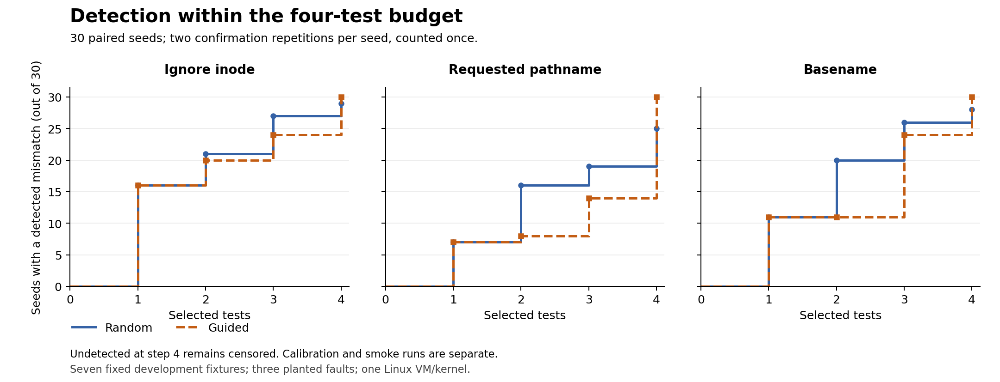

# Thirty-seed finite fixture-selection pilot v0

Recorded: 2026-11-11. Protocol: sentinel-fixture-selection-v0. Main collection
commit: 8c6780a40ead4b797773bac5f9c6c8402d0d9e7c. This is a descriptive pilot
on the project's own reference enforcer with three deliberately inserted faults.

## Result

| Planted fault | Random: detected by test 4 | Guided: detected by test 4 |
|---|---:|---:|
| Ignore inode | 29/30 | 30/30 |
| Requested pathname | 25/30 | 30/30 |
| Basename | 28/30 | 30/30 |

Guidance detected each fault within four selections in every seed. Random
had one, five and two undetected seeds respectively. Random detected more
seeds by step 2 for every fault. Guidance therefore improved detection at
the final budget while frequently delaying first detection. This finite
development-set result does not establish a general strategy advantage.



[Vector figure](figures/pilot_v0_detection.svg).

## Fixed design

- Seven existing, qualified fixture families; four distinct selections per
  strategy without replacement; exactly seeds 0..29.
- Random uniformly chooses remaining cases. Guided greedily adds uncovered
  semantic single/pair tokens, breaking ties with its seeded random generator.
- Both methods use their own Random(seed) and receive the same qualified
  candidates, budgets and model. The selected plan is shared across mutants.
- The selectors see semantic facts and their own coverage state. They cannot
  consult fault labels, mismatch verdicts or known witness names.
- The protocol and planner were published in 1189529 before kernel comparison.
  Calibration/source were published in 9fb5bfa, smoke in db044e8 and the batch
  launcher in 8c6780a before main collection. No rules were tuned after the
  unfavourable seed-0 smoke latency result.
- Every main seed has two fresh repetitions. Those repetitions confirm one
  seed rather than adding independent samples. Smoke/calibration are excluded.

The experiment uses prepared native ELF files, exact-cgroup scope, the allowed
file held open, and device major/minor plus inode identity. Fixture operations
finish before exec. The kernel programs retain scope and incoming-return gates.
The shared policy-map layout is 160 bytes. Earlier-denial composition itself
has not been tested.

## Detection by step and censoring

All entries below count seeds out of the planned thirty. First mismatch means
the earliest selected mutant case whose independent outcome differs from the
unchanged model. The runner continues all four selected cases, so a first
position is a discovery metric, not the total number of cases actually run.

| Fault | Strategy | Detected by 1 | By 2 | By 3 | By 4 | Censored after 4 |
|---|---|---:|---:|---:|---:|---:|
| Ignore inode | random | 16 | 21 | 27 | 29 | 1 |
| Ignore inode | guided | 16 | 20 | 24 | 30 | 0 |
| Requested pathname | random | 7 | 16 | 19 | 25 | 5 |
| Requested pathname | guided | 7 | 8 | 14 | 30 | 0 |
| Basename | random | 11 | 20 | 26 | 28 | 2 |
| Basename | guided | 11 | 11 | 24 | 30 | 0 |

An undetected seed has first_mismatch=null in JSON and an empty first-position
field in CSV, with censored=True. It means >4; no detection at step 5 is
invented. The distribution CSV also gives counts first detected at steps 1..4.
No detected-only average or pooled independent-sample significance test is used.

## Paired first-detection comparison

| Planted fault | Guided earlier | Same observed position | Guided later | Both censored |
|---|---:|---:|---:|---:|
| Ignore inode | 5 | 19 | 6 | 0 |
| Requested pathname | 7 | 12 | 11 | 0 |
| Basename | 3 | 16 | 11 | 0 |

Each row sums to thirty paired seeds. If one method is censored and the other
detects within budget, the observed method is earlier within the horizon.
Two censored values would be reported separately; they would not establish
an equal detection time. There were no such pairs in this batch.

All candidates initially contribute 15 semantic tokens, so the two seeded
selectors share their first choice in this implementation. Their step-1
counts are therefore equal. Later guided choices maximise declared semantic
coverage rather than a fault's discovery probability. The earlier seed-0
preview's 46/52 versus 39/52 coverage counts were not detection evidence.

## Independent checks and controls

The offline reader verifies the source bytes against the reviewed calibrated
versions, regenerates the four C program texts and checks their hashes, then
validates calibration, smoke and all thirty raw main reports. It checks the
audit sequence, one invocation per seed, exact report hashes, consistent
environment, frozen plans, cleanup and complete repeated logical traces.

A separate outcome classifier rechecks every userspace observation:

- ALLOW requires the exact native ELF token, exit 0 and no exec error.
- DENY requires exec EPERM, no marker and harness exit 125.
- Other outcomes invalidate the analysis. Expected decisions are recomputed
  from recorded scope and device/inode identities, independently of the
  runner's outcome function and the model's expected_decision function.

These checks do not make the whole project an independently developed oracle:
fixtures, model and reference implementation still share a development origin.
The outcome evidence is independent of the BPF program's decision logging.

| Main-run measurement | Verified total |
|---|---:|
| Planned / valid seeds | 30 / 30 |
| Invalid / inconclusive / missing seeds | 0 / 0 / 0 |
| Fresh confirmation repetitions | 60 |
| Successful baseline executions | 420/420 |
| Correct-reference model matches | 420/420 |
| Selected mutant observations | 1,440 |
| Controlled fixture exec attempts | 2,280 |
| Detached policy probes | 240 |
| Removed temporary workload groups | 60 |

No main report outside the audit was present. No retry or favourable-result
selection was observed. All 180 strategy/mutant cells agreed logically across
their two repetitions; cells and repeated observations are not independent seeds.

## Data, environment and cost

- [Batch audit](../results/pilot_batch_v0/batch.jsonl): schema
  sentinel-selection-batch-v0, run ID 073ce4e917f304fa, SHA-256
  152d3f583605189c9c9fdf98824b911d001a0e9f13c55d74b3e9fcc5135cccf1.
- [Verified summary and source/report hashes](../results/pilot_analysis_v0/summary.json).
- [Six-row distribution and cumulative-count CSV](../results/pilot_analysis_v0/summary.csv).
- [180 per-seed strategy/mutant rows and raw-report references](../results/pilot_analysis_v0/per_seed.csv).
- [Paired counts](../results/pilot_analysis_v0/paired.csv).
- Raw reports are results/pilot_seedN_TIMESTAMP_NONCE.jsonl. Console logs and
  dispatch records are retained in results/pilot_batch_v0/. The summary lists
  every raw report and console hash; calibration and smoke remain separate.
- Kernel 6.8.0-149-generic; experiment Python 3.12.3; python3-bpfcc, libbpfcc
  and bpfcc-tools each 0.29.1+ds-1ubuntu7. Current analysis also reproduced all
  frozen plans under Python 3.12.14.
- Audit elapsed time: 1071.526 seconds (about
  17 minutes 51.5 seconds). Whole-worker durations sum to
  1048.615 seconds. These include BCC compilation,
  qualification, confirmation and cleanup; they are not enforcement overhead.
  Control/confirmation counts are separated above. Individual phase-load
  durations remain in raw phase_loaded events; other setup/cleanup costs were
  not separately timed. Timing is supplementary to the selection-count metric.

## Reproduce without running kernel experiments

Use the committed raw dataset and original experimental inputs with Python
3.12 on Linux. The analysis uses standard-library modules and the existing
Python helpers. It does not call the BCC loader, start services or need sudo.

```bash
cd ~/runtime-sentinel
/usr/bin/python3 analyse_pilot_v0.py --check-derived results/pilot_analysis_v0
/usr/bin/python3 -m unittest discover -s tests -v
```

The strict v0 reader rejects changed, missing or inconsistent inputs rather
than silently dropping seeds. Its default mode only verifies and prints.
--write-dir creates a new output directory and refuses to overwrite one.
The seven new analysis tests protect raw outcome and censoring semantics;
with the existing twenty checks, there are 27 pure-Python tests.

Figure generation is optional and uses Matplotlib (3.10.8 for the supplied
PNG/SVG). It is not a kernel-runner dependency. Choose a new output prefix:

```bash
/usr/bin/python3 plot_pilot_v0.py --summary results/pilot_analysis_v0/summary.json --output-prefix /tmp/sentinel-pilot-figure-v0
```

## Limits and next work

The seven fixtures and three faults are known development cases, not held-out
programs or a production-engine evaluation. The small fixed domain can favour
particular coverage features. Seeds share plans across faults and methods, so
their strategy/mutant cells should not be pooled as independent samples.

The oracle is state-free; selector coverage is the only evolving selection
state here. Broader fault families, stateful filesystem sequences, an immutable
boundary for scope-removing mutants, actual prior-denial composition and a
real-engine adapter remain later work. No Linux/product vulnerability,
novelty or general performance improvement follows from these results.

Preserve this result, its slower guided detections and censored random runs.
Any feature tuning, budget change, new faults or stateful contract belongs in
a separately specified next-version evaluation rather than a rewrite of v0.
