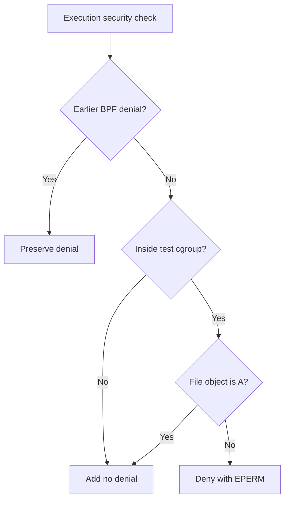

# Sentinel execution-policy contract v0

Status: Draft specification. The model, independent execution-outcome harness and scoped BCC reference enforcer are implemented. One recorded VM run matched the five in-scope expectations and one outside-scope control. This does not verify the whole contract; prior-denial composition remains untested.

## Purpose

Define expected behaviour before writing an enforcer.
The existing execution observer remains a diagnostic tool.

## Rule and scope

- The harness will create one dedicated cgroup v2 for test processes.
- Only processes in that exact cgroup are controlled by this rule.
- Inside that group, allow execution only of the chosen file object A.
- Deny execution of other supported executable file objects with EPERM.
- Outside that group, preserve the incoming decision without adding a denial.
- Always preserve a denial from an earlier BPF program.
- An allow decision from our rule does not override other Linux security checks.

## Scope identifier and binding

Use the kernel's 64-bit cgroup v2 ID for scope membership. Userspace obtains
the ID of the chosen live cgroup through name_to_handle_at(), using the
eight-byte cgroup file-handle format used by the Linux BPF self-tests.
The LSM program reads bpf_get_current_cgroup_id() and will compare it with
the registered target ID. Do not substitute a generic directory inode
without a documented mapping. In the canonical diagnostic, the inode is
printed only for diagnosis and is not the reference ID or a fallback.

Resolve each selected group's ID while that group is live. Resolve it again
when creating a replacement group. Do not reuse IDs recorded from finished
test services or previous boots. Keep the trusted policy controller outside
the workload cgroup. An allowed executable's device/inode identity and a
workload's cgroup ID are different identifiers.

Lookup diagnostics passed in the lab's SSH session and a temporary
service. A separate observation-only classifier passed one inside and one
outside case. The enforcement harness then matched five in-scope decisions
and one outside-scope control; its controller stayed outside the workload.
The lookup diagnostics themselves do not block execution. Namespace changes and concurrent changes to membership
or cgroup lifetime during an armed case remain outside the initial contract.

## File identity

Identify A using device major number, device minor number and inode number.
Do not compare only filenames, process names or file contents.
Bind A before the test operations and keep it open for the policy lifetime.
Renaming A or reaching it through a link does not create another file object.
A fresh copy has another identity, even when its contents match A.

## Initial supported conditions

Use direct execve calls on controlled native ELF executables.
An ELF executable is a normal Linux binary program.
Use a private test directory on one filesystem and a fresh setup for each case.
The harness and policy controller are trusted and remain outside the test cgroup.
File contents and policy bindings stay fixed during each case.

## Five expected cases

These predictions define the fixed cases. Their first kernel enforcement run matched all five, plus an outside-scope control; see [the result record](enforcement_results_v0.md).

| Case | Action | Expected | Reason |
|---|---|---|---|
| allow_original | Execute A | Allow | A is the chosen object |
| deny_other | Execute different executable B | Deny | B is another object |
| allow_symlink | Execute a symbolic link to A | Allow | It resolves to A |
| allow_renamed | Rename A and execute its new name | Allow | Its identity remains A |
| deny_copy | Copy A to a fresh file and execute the copy | Deny | The copy is another object |

## Reference decision flow

The arrows show the decision order in the reference LSM program. The source preserves an incoming nonzero BPF return value, but the first six cases do not exercise an actual earlier BPF denial.

## Outcome verification

First confirm that each fixture can execute without our enforcer.
Then record the actual exec error and a marker printed by the test executable.
An allowed test should reach its marker and finish successfully.
A denied test should report EPERM and should not reach its marker.
Other filesystem errors, timeouts and unsupported cases need separate investigation.
An observer event or a missing alert is not sufficient proof of an outcome.

## Initial limits

Scripts, execveat, descriptor-based execution and namespace changes are outside v0.
Concurrent mutations, deletion/recreation, inode reuse and policy updates are outside v0.
This contract does not claim protection against privileged tampering.
Security updates and the final supported lab kernel still need review before evaluation.

## Implemented model and its limits

`policy_model.py` compares file identities obtained through Python `os.stat`.
Its fixtures copy `/usr/bin/true` into private directories, perform the five
specified operations and compare predictions with fixed expected answers.
The fixtures never execute these copied ELF programs or attach an eBPF policy.

The model accepts `in_scope`, `earlier_denial` and `supported` as supplied facts.
It does not discover kernel cgroup membership or previous BPF decisions.
The five fixtures exercise supported, in-scope cases with no earlier denial.
Passing them checks those examples, not kernel enforcement or the full contract.

## Next step

The first fixed enforcement result was published in 7194e41 and the inode
fault in 81b8ec9. A separate pathname fault was also detected in two fresh
trials; see its [result](mutant_path_results_v0.md) and the
[fault catalog](fault_catalog_v0.md). These diagnostics retain the original
file-object expectations; a requested-path comparison is a deliberate fault
relative to this contract. A later [seven-case diagnostic](mutant_basename_results_v0.md)
added a different-object copy with A's basename, expected DENY, and distinguished
the two name-based faults in two fresh trials. This fixture uses the existing
copy semantics; it does not add deletion/recreation or concurrent mutations.
The [pilot protocol](pilot_protocol_v0.md) now fixes the shared seven-case
selection domain, model-derived feature coverage, budget, seeds and reporting
rules before kernel comparison. The pure-Python preview is not enforcement
evidence. The [common-runner calibration](calibration_results_v0.md) passed
all seven baseline and reference cases in two fresh repetitions and qualified
all three planted faults, including ignore_inode on the seventh fixture.
The calibrated source and report were published in 9fb5bfa. A separate
[seed-0 smoke run](selection_smoke_results_v0.md) passed in two fresh repetitions:
first mismatch was random/guided = 1/1 for ignore_inode, 2/4 for the
requested-path fault and 1/1 for basename_identity. This smoke run is
separate from main-pilot data and does not establish a strategy advantage.
Next, preserve its raw report and collect fresh main runs for seeds 0..29
under the unchanged protocol before expanding faults or stateful transitions.
The frozen protocol retains its original pre-runner status text as history.
An independent immutable experiment boundary is required before any
scope-removing mutant. Actual prior-denial composition remains untested.
Keep unsupported transitions outside v0 until their semantics and independent
measurements are specified. Persistent boot selection of 6.8.0-149-generic
was verified after reboot. Remaining package updates still need review;
changed experimental environments require requalification.
